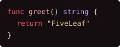
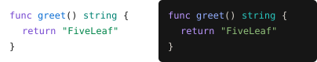
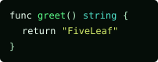

# FiveLeaf plugins

Browse each color theme and file icon set below. Click a name to open its files and installation instructions. In FiveLeaf, search **Settings → Plugins** for the same name.

## Color themes

| Plugin | Preview | Install |
| --- | --- | --- |
| [One Dark Pro](one-dark-pro/) |  | `fiveleaf plugin install one-dark-pro` |
| [Ayu](ayu/) |  | `fiveleaf plugin install ayu` |
| [Blood Moon](blood-moon/) |  | `fiveleaf plugin install blood-moon` |
| [Claude](claude/) |  | `fiveleaf plugin install claude` |
| [Cursor](cursor/) |  | `fiveleaf plugin install cursor` |
| [Grok Bot](grok-bot/) |  | `fiveleaf plugin install grok-bot` |
| [Jack-o'-Lantern](jack-o-lantern/) |  | `fiveleaf plugin install jack-o-lantern` |
| [Purple Gold](purple-gold/) |  | `fiveleaf plugin install purple-gold` |
| [Qoder](qoder/) |  | `fiveleaf plugin install qoder` |
| [The Matrix](the-matrix/) |  | `fiveleaf plugin install the-matrix` |
| [Witch's Brew](witchs-brew/) |  | `fiveleaf plugin install witchs-brew` |

## File icon themes

| Plugin | Preview | Install |
| --- | --- | --- |
| [Material Icon Theme](material-icons/) |  | `fiveleaf plugin install material-icons` |
| [Ayu Icons](ayu-icons/) |  | `fiveleaf plugin install ayu-icons` |
| [Catppuccin Latte Icons](catppuccin-latte-icons/) |  | `fiveleaf plugin install catppuccin-latte-icons` |
| [Catppuccin Mocha Icons](catppuccin-mocha-icons/) |  | `fiveleaf plugin install catppuccin-mocha-icons` |
| [FiveLeaf File Icons](fiveleaf-file-icons/) |  | `fiveleaf plugin install fiveleaf-file-icons` |
| [Seti Icons](seti-icons/) |  | `fiveleaf plugin install seti-icons` |

The built-in FiveLeaf color theme is available on first launch. Each adaptive theme includes its light and dark palettes in one plugin. Color themes and file icons can be mixed freely.

## Switching from the original bundles

Install the individual themes and icon sets you use. Then remove the old bundles with `fiveleaf plugin remove fiveleaf-themes` and `fiveleaf plugin remove fiveleaf-icons`. FiveLeaf recognizes your saved selections.

## Local development

Run `fiveleaf plugin dev ./one-dark-pro` from this checkout to work on One Dark Pro. Each plugin directory contains a manifest, its own assets, a preview and its licenses. The marketplace reads [index.json](index.json).
