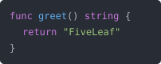
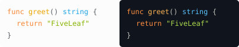
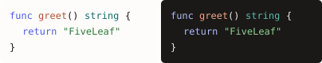
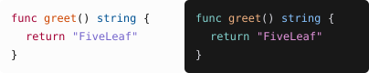
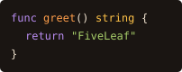
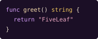
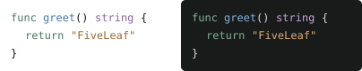
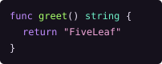

# FiveLeaf plugins

Choose a [keymap](#keyboard-shortcuts), [agent](#agents), [color theme](#color-themes), [file icon theme](#file-icon-themes), [language server](#language-servers), [formatter](#formatters) or [editor tool](#editor-tools). Each plugin can be installed by name in **Settings → Plugins** or with the FiveLeaf CLI.

## Color themes

| Plugin | Preview | Install |
| --- | --- | --- |
| [One Dark Pro](one-dark-pro/) |  | `fiveleaf plugin install one-dark-pro` |
| [Ayu](ayu/) |  | `fiveleaf plugin install ayu` |
| [Blood Moon](blood-moon/) |  | `fiveleaf plugin install blood-moon` |
| [Claude](claude/) |  | `fiveleaf plugin install claude` |
| [Cursor](cursor/) |  | `fiveleaf plugin install cursor` |
| [Grok Bot](grok-bot/) |  | `fiveleaf plugin install grok-bot` |
| [Jack-o'-Lantern](jack-o-lantern/) |  | `fiveleaf plugin install jack-o-lantern` |
| [Purple Gold](purple-gold/) |  | `fiveleaf plugin install purple-gold` |
| [Qoder](qoder/) |  | `fiveleaf plugin install qoder` |
| [The Matrix](the-matrix/) |  | `fiveleaf plugin install the-matrix` |
| [Witch's Brew](witchs-brew/) |  | `fiveleaf plugin install witchs-brew` |

## File icon themes

| Plugin | Preview | Install |
| --- | --- | --- |
| [Material Icon Theme](material-icons/) |  | `fiveleaf plugin install material-icons` |
| [Ayu Icons](ayu-icons/) |  | `fiveleaf plugin install ayu-icons` |
| [Catppuccin Latte Icons](catppuccin-latte-icons/) |  | `fiveleaf plugin install catppuccin-latte-icons` |
| [Catppuccin Mocha Icons](catppuccin-mocha-icons/) |  | `fiveleaf plugin install catppuccin-mocha-icons` |
| [FiveLeaf File Icons](fiveleaf-file-icons/) |  | `fiveleaf plugin install fiveleaf-file-icons` |
| [Seti Icons](seti-icons/) |  | `fiveleaf plugin install seti-icons` |

The built-in FiveLeaf color theme is available on first launch. Each adaptive theme includes its light and dark palettes in one plugin. Color themes and file icons can be mixed freely.

## Keyboard shortcuts

After installing a keymap, choose it in **Settings → Keyboard Shortcuts**. FiveLeaf recognizes saved VS Code, JetBrains and Sublime Text selections, and personal shortcuts take priority.

| Plugin | Install |
| --- | --- |
| [JetBrains Keymap](keymap-jetbrains/) | `fiveleaf plugin install keymap-jetbrains` |
| [Sublime Text Keymap](keymap-sublime/) | `fiveleaf plugin install keymap-sublime` |
| [VS Code Keymap](keymap-vscode/) | `fiveleaf plugin install keymap-vscode` |

## Agents

Install the agent's CLI and sign in there. Install its FiveLeaf plugin, enable it in **Settings → Plugins**, then choose the agent in chat. Pi, Codex and Claude Code also need Node.js for their ACP adapters.

| Plugin | Install |
| --- | --- |
| [Claude Agent](agent-claude/) | `fiveleaf plugin install agent-claude` |
| [Codex Agent](agent-codex/) | `fiveleaf plugin install agent-codex` |
| [DeepSeek TUI (DSH) Agent](agent-dsh/) | `fiveleaf plugin install agent-dsh` |
| [Gemini CLI Agent](agent-gemini/) | `fiveleaf plugin install agent-gemini` |
| [Kimi Code Agent](agent-kimi/) | `fiveleaf plugin install agent-kimi` |
| [OMP (Oh My Pi) Agent](agent-omp/) | `fiveleaf plugin install agent-omp` |
| [OpenCode Agent](agent-opencode/) | `fiveleaf plugin install agent-opencode` |
| [Pi Agent](agent-pi/) | `fiveleaf plugin install agent-pi` |
| [Qwen Code Agent](agent-qwen/) | `fiveleaf plugin install agent-qwen` |

## Language servers

| Plugin | Install |
| --- | --- |
| [Bash / Shell Language Server](lsp-bash/) | `fiveleaf plugin install lsp-bash` |
| [C / C++ Language Server](lsp-clangd/) | `fiveleaf plugin install lsp-clangd` |
| [C# Language Server](lsp-csharp/) | `fiveleaf plugin install lsp-csharp` |
| [CSS / SCSS / Less Language Server](lsp-css/) | `fiveleaf plugin install lsp-css` |
| [Dockerfile Language Server](lsp-docker/) | `fiveleaf plugin install lsp-docker` |
| [Go Language Server](lsp-go/) | `fiveleaf plugin install lsp-go` |
| [HTML Language Server](lsp-html/) | `fiveleaf plugin install lsp-html` |
| [JSON / JSONC Language Server](lsp-json/) | `fiveleaf plugin install lsp-json` |
| [Java Language Server](lsp-java/) | `fiveleaf plugin install lsp-java` |
| [Lua Language Server](lsp-lua/) | `fiveleaf plugin install lsp-lua` |
| [Markdown Language Server](lsp-markdown/) | `fiveleaf plugin install lsp-markdown` |
| [PHP Language Server](lsp-php/) | `fiveleaf plugin install lsp-php` |
| [Python Language Server](lsp-python/) | `fiveleaf plugin install lsp-python` |
| [Ruby Language Server](lsp-ruby/) | `fiveleaf plugin install lsp-ruby` |
| [Rust Language Server](lsp-rust/) | `fiveleaf plugin install lsp-rust` |
| [Svelte Language Server](lsp-svelte/) | `fiveleaf plugin install lsp-svelte` |
| [TOML Language Server](lsp-toml/) | `fiveleaf plugin install lsp-toml` |
| [Terraform Language Server](lsp-terraform/) | `fiveleaf plugin install lsp-terraform` |
| [TypeScript / JavaScript Language Server](lsp-typescript/) | `fiveleaf plugin install lsp-typescript` |
| [Vue Language Server](lsp-vue/) | `fiveleaf plugin install lsp-vue` |
| [YAML Language Server](lsp-yaml/) | `fiveleaf plugin install lsp-yaml` |

## Formatters

| Plugin | Install |
| --- | --- |
| [ClangFormat Formatter](format-clang/) | `fiveleaf plugin install format-clang` |
| [Prettier Formatter](format-prettier/) | `fiveleaf plugin install format-prettier` |
| [Ruff Formatter](format-ruff/) | `fiveleaf plugin install format-ruff` |

## Editor tools

| Plugin | Install |
| --- | --- |
| [TODOs](todos/) | `fiveleaf plugin install todos` |
| [Word Count](word-count/) | `fiveleaf plugin install word-count` |

## Switching from the original bundles

Install the individual themes and icon sets you use. Then remove the old bundles with `fiveleaf plugin remove fiveleaf-themes` and `fiveleaf plugin remove fiveleaf-icons`. FiveLeaf recognizes your saved selections.

## Local development

Run `fiveleaf plugin dev ./one-dark-pro` from this checkout to work on One Dark Pro. Each plugin directory contains a manifest, installation instructions and a license. The marketplace reads [index.json](index.json).
