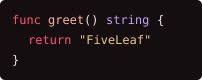

# Blood Moon

Crimson and old gold under a red moon. Dark color theme.



```sh
fiveleaf plugin install blood-moon
```

Open **Color Theme…** in the command palette and choose **Blood Moon**.

FiveLeaf's candlelit pumpkin, plum and green potion, and crimson and old gold palettes.
