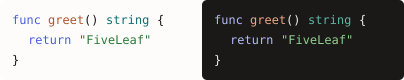

# Claude

Ivory and near-black, with Claude's orange. Follows light and dark appearance.



```sh
fiveleaf plugin install claude
```

Open **Color Theme…** in the command palette and choose **Claude**.

FiveLeaf's adaptation of Claude Code's light and dark terminal colors, including the orange accent and periwinkle selection.
