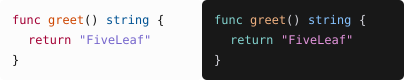

# Cursor

Cursor's greys, with its blue. Follows light and dark appearance.



```sh
fiveleaf plugin install cursor
```

Open **Color Theme…** in the command palette and choose **Cursor**.

Cursor Light and Cursor Dark workbench, syntax and terminal colors, with FiveLeaf adjustments for selection visibility and contrast.
