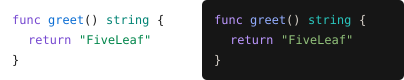

# Grok Bot

Grok Bot's Sand: monochrome, with its blue. Follows light and dark appearance.



```sh
fiveleaf plugin install grok-bot
```

Open **Color Theme…** in the command palette and choose **Grok Bot**.

Grok's Sand Light and Sand Dark palettes. The light syntax colors use the app's color primitives, and the dark syntax and ANSI colors draw on the terminal shown on x.ai.
