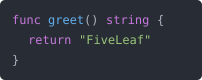

# One Dark Pro

Charcoal with vivid blue, green and purple syntax. Dark color theme.



```sh
fiveleaf plugin install one-dark-pro
```

Open **Color Theme…** in the command palette and choose **One Dark Pro**.

Workbench, syntax and ANSI colors from the default `themes/OneDark-Pro.json` in `zhuangtongfa.material-theme` 3.20.6, with FiveLeaf control states. [Upstream](https://github.com/Binaryify/OneDark-Pro) · [MIT license](licenses/One-Dark-Pro.txt)
