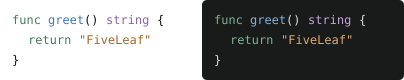

# Qoder

Qoder's Forest greens. Follows light and dark appearance.



```sh
fiveleaf plugin install qoder
```

Open **Color Theme…** in the command palette and choose **Qoder**.

Qoder's Forest Light and Forest Dark workbench colors. FiveLeaf draws the syntax colors from the Forest chart series.
